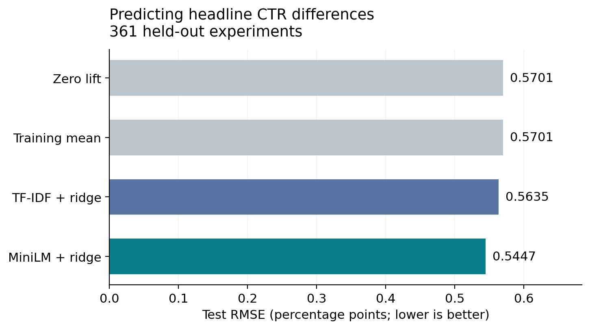
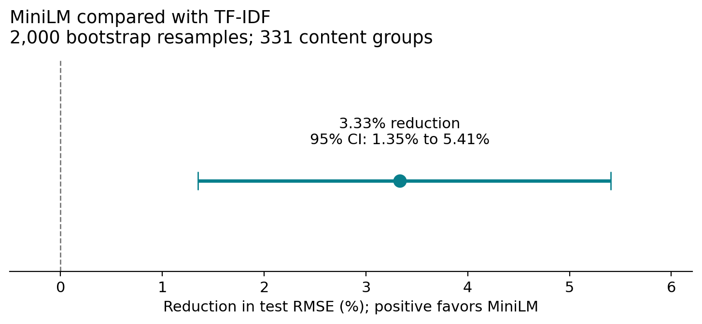

# Predicting headline experiment effects

**Dibya Deepta Mishra · November 6, 2026**

Can headline text help predict the observed click-through-rate difference between two experimental variants? This project compares TF-IDF and frozen MiniLM embeddings on public Upworthy experiments. Data preparation ran with local PySpark on EC2; modeling ran on CPU in a SageMaker notebook instance.

On **361 held-out experiments**, MiniLM + ridge reduced RMSE by **3.33% relative to TF-IDF + ridge**. A paired bootstrap over **331 content groups** gave an approximate 95% interval of **1.35%–5.41%**. This is a predictive comparison against noisy experimental estimates, not a measured increase in clicks.



## Relationship to PIE

Gordon, Moakler, and Zettelmeyer's [Predicted Incrementality by Experimentation (PIE) for Ad Measurement](https://www.nber.org/papers/w35044) learns relationships between campaign features and experimentally measured advertising effects, including features observed after a campaign. This project borrows the idea of learning across experiments. Its inputs are headline text and its outcome is a difference between headline variants. It does not reproduce PIE's advertising data, feature set, estimand, or reported performance.

## Results

All errors are in **percentage points of CTR**; lower is better. For example, a change from 3.0% CTR to 3.4% is 0.4 percentage points.

| Model | Validation RMSE | Test RMSE | Test MAE |
|---|---:|---:|---:|
| Zero lift | 0.5588 | 0.5701 | 0.4073 |
| Training mean | 0.5587 | 0.5701 | 0.4073 |
| TF-IDF + ridge | 0.5475 | 0.5635 | 0.4035 |
| MiniLM + ridge | **0.5215** | **0.5447** | **0.3914** |

The absolute RMSE reduction relative to TF-IDF is **0.01878 pp**, with a 95% percentile bootstrap interval of **0.00740–0.03072 pp**. See `results/` for full precision.



## Data and sample construction

The source is the [Upworthy Research Archive exploratory dataset](https://upworthy.natematias.com/about-the-archive). The small processed CSVs included here are derivatives of this public dataset; attribution and the CC BY 4.0 license are documented in [DATA_LICENSE.md](DATA_LICENSE.md).

| Stage | Experiments | Variant rows / pairs |
|---|---:|---:|
| Original exploratory CSV | 4,873 | 22,666 variants |
| After date-window exclusions | 3,823 | 18,388 variants |
| Eligible same-image comparisons | 1,930 | 8,774 variants |
| One selected pair per experiment | 1,930 | 1,930 pairs |
| Training | 1,172 | 1,172 pairs |
| Validation | 397 | 397 pairs |
| Test | 361 | 361 pairs |

1. Exclude an entire experiment if any arm's creation date falls in June 25, 2013–January 10, 2014, inclusive, following the archive's [randomization warning](https://upworthy.natematias.com/2024-06-upworthy-archive-update.html).
2. Require positive impressions, valid clicks, nonempty headlines and image IDs. Normalize whitespace. Compare distinct headlines within the same experiment, image ID, and excerpt. Excerpt matching is an additional comparability restriction; the archive documentation does not identify it as displayed test content.
3. Order the headlines lexicographically as A and B. Choose one pair per experiment by a deterministic SHA-256 hash, with row IDs breaking ties. Neither outcomes nor impression counts choose the pair.
4. Link eligible experiments whenever any of their cleaned variants share a normalized headline or slug. Assign the resulting connected components to splits using a fixed hash. All **1,753 content groups** stay within one split; these are approximate related-content groups, not verified article identities.
5. Calculate the label as `100 * (clicks_b / impressions_b - clicks_a / impressions_a)`.

The holdout is created within the archive's exploratory data. It is not the archive publishers' separate confirmatory dataset. The split is grouped, not chronological.

## Models and evaluation

- **Baselines:** zero for every pair; the mean lift of the training pairs.
- **TF-IDF:** training-only vocabulary and IDF, unigrams and bigrams, 5,000 maximum features, minimum document frequency 2, sublinear TF. Use `features(B) - features(A)`.
- **MiniLM:** frozen [`all-MiniLM-L6-v2`](https://huggingface.co/sentence-transformers/all-MiniLM-L6-v2), 384-dimensional normalized headline vectors, B-minus-A difference. Exact revision: `1110a243fdf4706b3f48f1d95db1a4f5529b4d41`. No encoder fine-tuning.
- **Regression:** ridge without an intercept, LSQR solver, tolerance `1e-6`. Both methods consider alpha values `[0.01, 0.1, 1, 10, 100, 1000]`; both select **10** by validation RMSE. The difference representation and zero intercept ensure that reversing A/B reverses the predicted sign.
- **Final evaluation:** models remain fitted on the 1,172 training pairs. There is no refit on train + validation. The notebook writes `evaluation_plan.json` before opening test data; this records choices but is not an external preregistration.
- **Uncertainty:** 2,000 paired resamples of the 331 whole test content groups, seed 20261106. Each sampled group contributes all its rows, including duplicates when a group is drawn again. Report 2.5th and 97.5th percentiles. Models are fixed throughout.

## Run locally

Extract this repository and work from its root folder. You do not need AWS or S3 to inspect or audit the saved results.

### 1. Audit the included results

```bash
python3 -m venv .venv-audit
source .venv-audit/bin/activate
python -m pip install -r requirements-audit.txt
python verify_results.py
```

To additionally verify the source, pair selection, and groups:

```bash
python download_data.py
python verify_results.py --raw data/raw/upworthy.csv
```

`download_data.py` checks SHA-256 and refuses changed source bytes. Expected raw checksum:

`8368313b060f4015a0c6fb34e6d788163cee29554144aba9390b14922eb9d8ce`

### 2. Reproduce modeling

Use Python 3.10 or 3.11 in a separate virtual environment. Install `requirements-modeling.txt`, then open `07_modeling.ipynb` with JupyterLab, or run `python 07_modeling.py` from the repository root. The script also has `# %%` markers for VS Code.

The first encoder run downloads pretrained weights. All inference uses CPU. Copy the project before rerunning if you want to retain the supplied results: execution overwrites local result files. Do not tune further models on this now-visible test set.

`results/modeling_environment.json` records the actual SageMaker versions, including Python 3.10.20 and Torch 2.10.0+cu128. The requirements file substitutes base Torch 2.10.0 for portability; a clean installation of that environment has not been tested here. It is a list of direct dependencies, not a full transitive lockfile. Numerical details may vary across platforms.

### 3. Reproduce Spark preparation, if needed

The original EC2 setup used Python 3.11.18, Java 17.0.21, and reported PySpark 4.3.0. Use a separate preprocessing environment with Java 17 and `requirements-preprocessing.txt`. Download the raw CSV, then run `01_inspect_data.py` through `06_export_data.py` in numeric order. These scripts resolve paths relative to their own location.

Spark ran with `local[2]` on a single EC2 machine. This demonstrates a Spark workflow, not distributed cluster performance. Some steps collect this small dataset to the driver; they would need redesign for much larger data. Modeling used a SageMaker notebook instance, not a managed training job or inference endpoint. CSVs moved by manual upload/download; no S3 workflow was used. No measured AWS cost total is available.

## What was checked in this package

An independent pandas-based audit verified the original source checksum, exclusions, candidate-pair selection, arm counts, content groups, split assignments, target arithmetic, test metrics, validation selection, and all bootstrap draws and intervals. Metrics are compared to tolerance `1e-8` pp because CSV serialization of float32 predictions can introduce tiny differences. The observed discrepancy was below `2e-10` pp.

See `results/review_verification.json`. The portable Python code and notebook cells were syntax checked. Spark execution, MiniLM inference, and model fitting were **not** rerun during packaging. The six original preparation scripts and numerical result files are retained. Notebook setup and paths were made portable and execution outputs cleared; the original uploaded archive remains the record of the executed notebook.

## Limits and next experiments

The targets have sampling error; the bootstrap interval does not establish accuracy against unobserved true effects. It conditions on the fitted models and current split, and assumes content groups provide suitable independent resampling units. Matching headline/slug values cannot guarantee all related articles have been grouped. Excluding the flagged window does not validate every remaining experiment. Overlap between public headlines and encoder pretraining data has not been audited.

This is a modest improvement in a historical, filtered dataset. It does not establish ad incrementality, revenue impact, deployment benefit, or a universal advantage for embeddings. Comparing these two representations also does not isolate a unique mechanism behind the improvement. Regression coefficients are predictive associations, not causal effects of individual words.

Useful next studies would add context-dependent headline scoring, account for uncertainty in the experimental labels, or evaluate on a future-period holdout. Any new model selection needs fresh evaluation data. A JEPA-style extension is a separate representation-learning proposal, not something implemented in this run.

## Files to read first

- [Journal post](JOURNAL_POST.md): accessible explanation of the question, design, and results.
- [Notebook](07_modeling.ipynb) / [VS Code script](07_modeling.py): sequential modeling workflow.
- [GitHub upload instructions](GITHUB_STEPS.md): publish from your Mac without restarting AWS.
- [Data attribution](DATA_LICENSE.md): source, license, and modifications.

## References

Gordon, B. R., Moakler, R., & Zettelmeyer, F. (2026). *Predicted Incrementality by Experimentation (PIE) for Ad Measurement*. NBER Working Paper 35044. https://doi.org/10.3386/w35044

Matias, J. N., Munger, K., Aubin Le Quéré, M., & Ebersole, C. (2021). *The Upworthy Research Archive, a time series of 32,487 experiments in U.S. media*. Scientific Data. https://doi.org/10.1038/s41597-021-00934-7

Archive documentation and update: https://upworthy.natematias.com/about-the-archive and https://upworthy.natematias.com/2024-06-upworthy-archive-update.html

Encoder: https://huggingface.co/sentence-transformers/all-MiniLM-L6-v2
